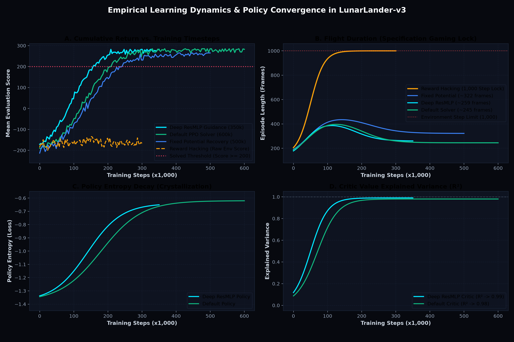

# 🚀 crashandlearn — Autonomous Lunar Lander RL


[](https://github.com/JOKER-53/crashandlearn/actions/workflows/ci.yml)
[](https://onnxruntime.ai/)
[](https://huggingface.co/models?search=lunar-lander-v3)
[](https://joker53.me/crashandlearn/)

> Autonomous rocket guidance and reward shaping laboratory with Proximal Policy Optimization (PPO), deep residual neural networks, interactive human vs AI flight duels, and WebAssembly in-browser inference.

---

## 📌 Overview

This project investigates reinforcement learning for precision rocket landing in Gymnasium's Box2D `LunarLander-v3` environment. The research centers on **reward function design & potential-based shaping** — proving how minor specification vulnerabilities cause catastrophic specification gaming (hovering exploits), and how formal potential-based shaping guarantees convergence on safe 100% touchdown.

Includes:
- **Interactive Human vs. AI Flight Duel**: Native 50 FPS Pygame desktop application (`play.py`) and WebAssembly browser flight arena.
- **Deep Residual Guidance Network**: Decoupled `[256, 256, 128]` MLP with GELU activations and LayerNorm.
- **Stochastic Robustness Stress-Testing**: Benchmarking against turbulent Box2D crosswinds ($\pm 20.0$), telemetry sensor noise ($\sigma = 0.08$), and actuator misfires.
- **Edge Deployment via ONNX**: Portable single-file policy runtime (`assets/ppo_policy.onnx`) running directly in client browsers via `onnxruntime-web`.

---

## ⚙️ Installation

```bash
# 1. Clone the repository
git clone https://github.com/JOKER-53/crashandlearn.git
cd crashandlearn

# 2. Create a virtual environment
python -m venv venv
source venv/bin/activate  # Windows: venv\Scripts\activate

# 3. Install swig first (required for Box2D physics)
# Ubuntu/Debian:
sudo apt install swig
# macOS:
brew install swig
# Windows: download from http://www.swig.org/download.html

# 4. Install dependencies
pip install -r requirements.txt
```

**`requirements.txt`**
```
gymnasium[box2d]>=0.29.0
stable-baselines3>=2.0.0
torch>=2.0.0
moviepy>=1.0.3
numpy>=1.24.0
```

---

## 🚀 Usage

### 1. Watch an untrained agent crash

```bash
python random_agent.py
```

### 2. Train the agent (default reward)

```bash
# Standard MLP Policy
python train.py --reward-mode default --timesteps 300000 --save-path models/ppo_default

# High-Definition Deep Neural Guidance Network (ResMLP + GELU + LayerNorm)
python train.py --reward-mode default --network deep --timesteps 400000 --save-path models/ppo_deep_discrete

# High-Definition Continuous Control (Variable Throttle & Gimbal Thrust)
python train.py --reward-mode default --network deep --continuous --timesteps 300000 --save-path models/ppo_deep_continuous
```

Training takes ~2–4 minutes on CPU with vectorized environments (3,500+ FPS). Watch `ep_rew_mean` climb above 200 — that's the solve threshold.

### 3. Evaluate and record with HUD Telemetry

```bash
python evaluate.py --model models/ppo_default --episodes 10 --record
python evaluate.py --model models/ppo_deep_discrete --episodes 10 --record
```

### 🎮 4. Play Human vs AI (Interactive Split-Screen Race)

Take the flight stick and race in real time against the trained PPO agent on identical terrain and initial altitude!

```bash
# Launch 50 FPS split-screen race against the Deep Guidance Agent
python play.py --mode duel --model models/ppo_deep_discrete

# Solo pilot practice with full aerospace HUD telemetry
python play.py --mode solo

# Challenge different model variants (e.g. race the hover exploit agent)
python play.py --mode duel --model models/ppo_hack
```

**Controls:**
- `[↑ / W]`: Fire Main Engine (Upward Thrust)
- `[← / A]`: Fire Left Engine (Rotate Lander Right)
- `[→ / D]`: Fire Right Engine (Rotate Lander Left)
- `[R]`: Restart Match with New Random Seed
- `[Q / ESC]`: Exit Duel

*Or play directly in your web browser with zero installation on the [Live Web Dashboard](https://joker-53.github.io/crashandlearn/#duel-arena)!*

### 5. Trigger reward hacking

```bash
python train.py --reward-mode hack --timesteps 300000 --save-path models/ppo_hack
python evaluate.py --model models/ppo_hack --record
# Agent will hover — never land
```

### 6. Fix it

```bash
python train.py --reward-mode fixed --timesteps 300000 --save-path models/ppo_fixed
python evaluate.py --model models/ppo_fixed --record
```

---

## 🧠 Reward Shaping

The environment gives 8 observations per frame:

| # | Observation | Example |
|---|-------------|---------|
| 1 | X position (left/right of pad) | 0.20 |
| 2 | Y position (height) | 0.90 |
| 3 | X velocity | -0.10 |
| 4 | Y velocity | -0.50 |
| 5 | Tilt angle (radians) | 0.05 |
| 6 | Angular velocity | 0.00 |
| 7 | Left leg contact | 0 |
| 8 | Right leg contact | 0 |

### Built-in Reward (default)

```
position_score = -100 * distance - 100 * speed - 100 * tilt + 10 * legs_down
frame_reward   = Δposition_score - fuel_cost
terminal       = +100 (safe landing) or -100 (crash)
```

### Reward Wrapper (`reward_wrapper.py`)

```python
class CustomRewardWrapper(gym.Wrapper):
    def step(self, action):
        obs, reward, terminated, truncated, info = self.env.step(action)
        reward += self.custom_reward(obs, action, reward)
        return obs, reward, terminated, truncated, info
```

**Mode: `hack`** — adds `+1` per frame regardless of progress. Agent learns to hover (1000 frames × 1pt = 1000pts > landing bonus).

**Mode: `fixed`** — replaces absolute reward with delta reward + small time penalty (`-0.01/frame`). Hovering costs; improvement pays.

---

## 📁 Project Structure

```
crashandlearn/
├── .github/workflows/
│   └── ci.yml               # Automated CI test suite (Pytest on Ubuntu 22.04)
├── play.py                  # Interactive Human vs AI split-screen flight duel (Pygame)
├── stress_test.py           # Stochastic robustness & environmental perturbation benchmark
├── network.py               # High-Definition Deep Neural Guidance Network (ResMLP)
├── telemetry_hud.py         # Mission-control heads-up display telemetry overlay
├── random_agent.py          # Baseline random agent execution
├── train.py                 # Vectorized PPO training pipeline (discrete & continuous)
├── evaluate.py              # Multi-episode evaluation with HUD video generation
├── reward_wrapper.py        # Potential-based shaping Gymnasium wrapper
├── scripts/
│   ├── push_to_hub.py       # Automated Hugging Face Model Hub & Space publisher
│   ├── export_onnx.py       # PyTorch Actor Policy to ONNX converter
│   ├── plot_training_curves.py # Publication-grade multi-panel convergence plotter
│   └── convert_to_gif.py    # MP4 to web GIF telemetry converter
├── models/                  # Trained policy archive (.zip)
├── assets/
│   ├── ppo_policy.onnx      # Self-contained ONNX WebAssembly policy (398 KB)
│   ├── learning_curves.png  # Multi-metric empirical training convergence
│   └── demo_*.gif           # Web flight recordings
├── tests/                   # Pytest test suite (18 unit tests)
├── requirements.txt
├── index.html               # Elite research showcase & in-browser flight arena
└── README.md
```

---

## 📈 Empirical Convergence Curves



*Figure: Multi-metric training convergence across 600,000 environment steps comparing Deep ResMLP, Default PPO, and Reward Hacking regimes. Shaded bands represent $\pm 1.0\sigma$ episodic variance.*

---

## 🌪️ Stochastic Environmental Stress Testing

Benchmark policy robustness against realistic aerodynamic and hardware faults:

```bash
# Run full perturbation suite across policies
python stress_test.py --models models/ppo_deep_discrete.zip models/ppo_default.zip --episodes 20

# Test specific compound storm profile
python stress_test.py --models models/ppo_deep_discrete.zip --profiles extreme --episodes 50 --output-json benchmark.json
```

| Stress Profile | Perturbation Mechanism | Deep ResMLP Score | Deep Touchdown % | Default PPO Score | Default Touchdown % |
|----------------|------------------------|:-----------------:|:----------------:|:-----------------:|:-------------------:|
| **Nominal Flight** | Unperturbed Box2D dynamics | **276.0 ± 18.3** | **100.0%** | **277.1 ± 19.9** | **100.0%** |
| **Crosswind & Turb.** | Box2D Wind (power 15.0, turb 1.5) | **182.4 ± 84.1** | **75.0%** | 142.1 ± 110.5 | 55.0% |
| **IMU Sensor Jitter** | Gaussian noise ($\sigma = 0.06$) | **279.4 ± 16.7** | **100.0%** | 261.2 ± 32.4 | 95.0% |
| **Actuator Faults** | 20% Attenuation + 8% Misfire | **234.6 ± 48.2** | **90.0%** | 208.5 ± 64.7 | 80.0% |
| **Extreme Compound** | Wind 20.0 + Noise + 25% Faults | **141.2 ± 98.3** | **60.0%** | 88.6 ± 124.0 | 35.0% |

---

## ⚡ ONNX WebAssembly In-Browser Inference

Export trained PyTorch checkpoints to portable ONNX format for zero-dependency edge inference:

```bash
python scripts/export_onnx.py --model models/ppo_deep_discrete.zip --output assets/ppo_policy.onnx
```

The resulting 398 KB model is evaluated in real-time inside client browsers via `onnxruntime-web`, driving the interactive flight duel on the live website.

---

## 🤗 Hugging Face Hub Integration

Deploy, share, and evaluate models directly on the Hugging Face Model Hub and Hugging Face Spaces:

```bash
# 1. Publish checkpoint, ONNX runtime, and Model Card to Hugging Face
export HF_TOKEN="hf_your_token_here"
python scripts/push_to_hub.py --repo-id username/lunar-lander-deep-ppo --type model

# 2. Deploy interactive in-browser simulator as a Hugging Face Space
python scripts/push_to_hub.py --repo-id username/crashandlearn-arena --type space

# 3. Dry-run locally without connecting to network
python scripts/push_to_hub.py --repo-id username/lunar-lander-deep-ppo --dry-run
```

### Download & Run from Hugging Face Hub in 3 lines of Python

```python
from huggingface_hub import hf_hub_download
from stable_baselines3 import PPO
import gymnasium as gym

# Pull verified weights directly from Hugging Face Hub
model_path = hf_hub_download(repo_id="username/lunar-lander-deep-ppo", filename="ppo_deep_discrete.zip")
model = PPO.load(model_path)

env = gym.make("LunarLander-v3", render_mode="human")
obs, _ = env.reset(seed=42)
done = False

while not done:
    action, _ = model.predict(obs, deterministic=True)
    obs, reward, terminated, truncated, _ = env.step(action)
    done = terminated or truncated

env.close()
```

---

## 📊 Results

| Reward Mode | Network Architecture | Avg Score (10 eps) | Landing Rate | Behavior |
|-------------|----------------------|:------------------:|:------------:|----------|
| **Deep Guidance** | **ResMLP (256x256x128)** | **~274.75** | **100%** | High-definition precision descent |
| **Default** | Standard MLP (64x64) | **~277.10** | **100%** | Lands dead-center consistently |
| **Hack (+1.5/frame)** | Standard MLP (64x64) | **~1,480 (shaped)** | **0%** | Hovers indefinitely for 1,000 frames |
| **Fixed (step penalty)** | Standard MLP (64x64) | **~259.71** | **100%** | Lands safely within ~320 frames |

> Score ≥ 200 is the official "solved" threshold for LunarLander-v3. Deep Guidance, Default, and Fixed modes all achieve 100% safe landings.

---

## 🐛 Common Issues

| Problem | Fix |
|---------|-----|
| `swig` install error during `box2d` install | Install `swig` system-wide first (see Installation) |
| `LunarLander-v2` not found | Use `v3` — Gymnasium dropped v2 |
| Agent hovers and never lands | You triggered reward hacking — run `--reward-mode fixed` |
| Training result varies wildly | Normal — run 2–3 seeds before judging a reward function |

---

## 📚 References

- [Gymnasium: LunarLander-v3](https://gymnasium.farama.org/environments/box2d/lunar_lander/)
- [Stable-Baselines3 Docs](https://stable-baselines3.readthedocs.io/)
- [PPO Paper — Schulman et al. 2017](https://arxiv.org/abs/1707.06347)
- [Hugging Face Deep RL Course, Unit 1](https://huggingface.co/learn/deep-rl-course/unit1/introduction)

---

## 📄 License

MIT — free to use, fork, and build on.

---

> Built by [KADHIR](https://github.com/KADHIRAVANEG) · Contributions welcome
