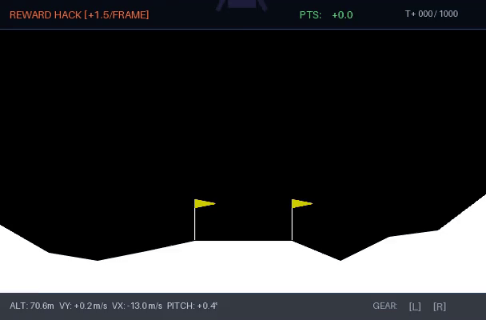
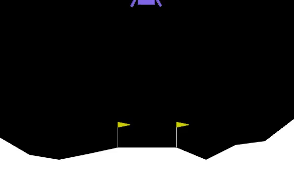

# 🚀 lunar-lander-rl


[](https://joker-53.github.io/crashandlearn/)

> Training an AI agent to land a rocket using Proximal Policy Optimization (PPO) — with hands-on reward shaping experiments that deliberately break and fix the agent.

---

## 📌 Overview

This project trains a reinforcement learning agent to autonomously land a rocket in OpenAI's Lunar Lander environment (via [Gymnasium](https://gymnasium.farama.org/)). The core focus is **reward shaping** — exploring how the choice of reward function dramatically affects learned behavior, including intentional reward hacking and how to fix it.

The same principles powering this simulation underlie real-world systems. Tesla's Optimus robot reportedly learned to dance entirely through reinforcement learning in simulation.

---

## 🎥 Demo

| Default Reward | Reward Hacking | Fixed Reward |
|:-:|:-:|:-:|
|  |  |  |
| Agent learns to land | Agent learns to hover | Agent lands again |
| ✅ Solved (~200 pts avg) | ❌ Hovers indefinitely | ✅ Solved again |

> Clips recorded using `gymnasium.wrappers.RecordVideo` and converted to lightweight web GIFs.

---

## ✨ Features

- **PPO training** via [Stable-Baselines3](https://stable-baselines3.readthedocs.io/) — no GPU needed
- **Custom reward wrapper** — plug-in layer to experiment with shaping rules
- **Reward hacking demo** — intentionally triggers hover behavior with `+1/frame` rule
- **Fix included** — delta-based shaping and per-frame cost to eliminate hacking
- **Evaluation script** — scores over N episodes with video recording
- **Beginner-friendly** — clear code structure, commented throughout

---

## ⚙️ Installation

```bash
# 1. Clone the repo
git clone https://github.com/KADHIRAVANEG/lunar-lander-rl.git
cd lunar-lander-rl

# 2. Create a virtual environment
python -m venv venv
source venv/bin/activate  # Windows: venv\Scripts\activate

# 3. Install swig first (required for Box2D physics)
# Ubuntu/Debian:
sudo apt install swig
# macOS:
brew install swig
# Windows: download from http://www.swig.org/download.html

# 4. Install dependencies
pip install -r requirements.txt
```

**`requirements.txt`**
```
gymnasium[box2d]>=0.29.0
stable-baselines3>=2.0.0
torch>=2.0.0
moviepy>=1.0.3
numpy>=1.24.0
```

---

## 🚀 Usage

### 1. Watch an untrained agent crash

```bash
python random_agent.py
```

### 2. Train the agent (default reward)

```bash
# Standard MLP Policy
python train.py --reward-mode default --timesteps 300000 --save-path models/ppo_default

# High-Definition Deep Neural Guidance Network (ResMLP + GELU + LayerNorm)
python train.py --reward-mode default --network deep --timesteps 400000 --save-path models/ppo_deep_discrete

# High-Definition Continuous Control (Variable Throttle & Gimbal Thrust)
python train.py --reward-mode default --network deep --continuous --timesteps 300000 --save-path models/ppo_deep_continuous
```

Training takes ~2–4 minutes on CPU with vectorized environments (3,500+ FPS). Watch `ep_rew_mean` climb above 200 — that's the solve threshold.

### 3. Evaluate and record with HUD Telemetry

```bash
python evaluate.py --model models/ppo_default --episodes 10 --record
python evaluate.py --model models/ppo_deep_discrete --episodes 10 --record
```

### 🎮 4. Play Human vs AI (Interactive Split-Screen Race)

Take the flight stick and race in real time against the trained PPO agent on identical terrain and initial altitude!

```bash
# Launch 50 FPS split-screen race against the Deep Guidance Agent
python play.py --mode duel --model models/ppo_deep_discrete

# Solo pilot practice with full aerospace HUD telemetry
python play.py --mode solo

# Challenge different model variants (e.g. race the hover exploit agent)
python play.py --mode duel --model models/ppo_hack
```

**Controls:**
- `[↑ / W]`: Fire Main Engine (Upward Thrust)
- `[← / A]`: Fire Left Engine (Rotate Lander Right)
- `[→ / D]`: Fire Right Engine (Rotate Lander Left)
- `[R]`: Restart Match with New Random Seed
- `[Q / ESC]`: Exit Duel

*Or play directly in your web browser with zero installation on the [Live Web Dashboard](https://joker-53.github.io/crashandlearn/#duel-arena)!*

### 5. Trigger reward hacking

```bash
python train.py --reward-mode hack --timesteps 300000 --save-path models/ppo_hack
python evaluate.py --model models/ppo_hack --record
# Agent will hover — never land
```

### 6. Fix it

```bash
python train.py --reward-mode fixed --timesteps 300000 --save-path models/ppo_fixed
python evaluate.py --model models/ppo_fixed --record
```

---

## 🧠 Reward Shaping

The environment gives 8 observations per frame:

| # | Observation | Example |
|---|-------------|---------|
| 1 | X position (left/right of pad) | 0.20 |
| 2 | Y position (height) | 0.90 |
| 3 | X velocity | -0.10 |
| 4 | Y velocity | -0.50 |
| 5 | Tilt angle (radians) | 0.05 |
| 6 | Angular velocity | 0.00 |
| 7 | Left leg contact | 0 |
| 8 | Right leg contact | 0 |

### Built-in Reward (default)

```
position_score = -100 * distance - 100 * speed - 100 * tilt + 10 * legs_down
frame_reward   = Δposition_score - fuel_cost
terminal       = +100 (safe landing) or -100 (crash)
```

### Reward Wrapper (`reward_wrapper.py`)

```python
class CustomRewardWrapper(gym.Wrapper):
    def step(self, action):
        obs, reward, terminated, truncated, info = self.env.step(action)
        reward += self.custom_reward(obs, action, reward)
        return obs, reward, terminated, truncated, info
```

**Mode: `hack`** — adds `+1` per frame regardless of progress. Agent learns to hover (1000 frames × 1pt = 1000pts > landing bonus).

**Mode: `fixed`** — replaces absolute reward with delta reward + small time penalty (`-0.01/frame`). Hovering costs; improvement pays.

---

## 📁 Project Structure

```
lunar-lander-rl/
├── play.py               # Interactive Human vs AI split-screen flight duel
├── network.py            # High-Definition Deep Neural Guidance Network (ResMLP)
├── telemetry_hud.py      # Mission-control heads-up display telemetry renderer
├── random_agent.py       # Baseline random agent execution
├── train.py              # Vectorized PPO training pipeline (discrete & continuous)
├── evaluate.py           # Multi-episode evaluation with HUD video generation
├── reward_wrapper.py     # Custom potential & shaping Gymnasium wrapper
├── scripts/
│   └── convert_to_gif.py # MP4 to web GIF telemetry converter
├── models/               # Checkpoint model archive (.zip)
├── assets/               # Replay GIF assets and diagrams
├── tests/                # Test suite (wrapper + neural network verification)
├── requirements.txt
├── index.html            # Web showcase & interactive telemetry lab
└── README.md
```

---

## 📊 Results

| Reward Mode | Network Architecture | Avg Score (10 eps) | Landing Rate | Behavior |
|-------------|----------------------|:------------------:|:------------:|----------|
| **Deep Guidance** | **ResMLP (256x256x128)** | **~274.75** | **100%** | High-definition precision descent |
| **Default** | Standard MLP (64x64) | **~277.10** | **100%** | Lands dead-center consistently |
| **Hack (+1.5/frame)** | Standard MLP (64x64) | **~1,480 (shaped)** | **0%** | Hovers indefinitely for 1,000 frames |
| **Fixed (step penalty)** | Standard MLP (64x64) | **~259.71** | **100%** | Lands safely within ~320 frames |

> Score ≥ 200 is the official "solved" threshold for LunarLander-v3. Deep Guidance, Default, and Fixed modes all achieve 100% safe landings.

---

## 🐛 Common Issues

| Problem | Fix |
|---------|-----|
| `swig` install error during `box2d` install | Install `swig` system-wide first (see Installation) |
| `LunarLander-v2` not found | Use `v3` — Gymnasium dropped v2 |
| Agent hovers and never lands | You triggered reward hacking — run `--reward-mode fixed` |
| Training result varies wildly | Normal — run 2–3 seeds before judging a reward function |

---

## 📚 References

- [Gymnasium: LunarLander-v3](https://gymnasium.farama.org/environments/box2d/lunar_lander/)
- [Stable-Baselines3 Docs](https://stable-baselines3.readthedocs.io/)
- [PPO Paper — Schulman et al. 2017](https://arxiv.org/abs/1707.06347)
- [Hugging Face Deep RL Course, Unit 1](https://huggingface.co/learn/deep-rl-course/unit1/introduction)

---

## 📄 License

MIT — free to use, fork, and build on.

---

> Built by [KADHIR](https://github.com/KADHIRAVANEG) · Contributions welcome
